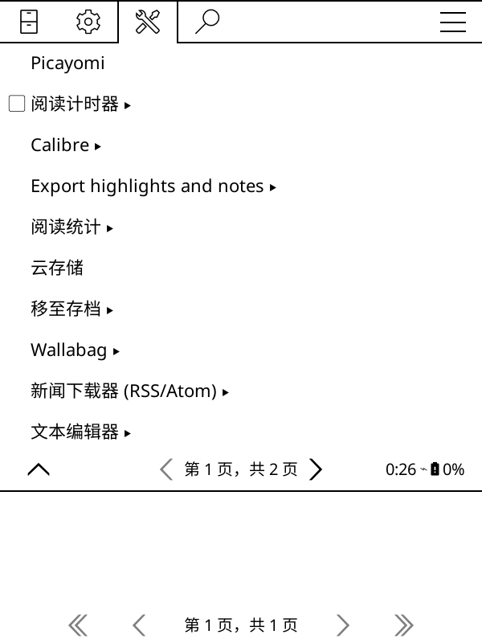

# PicaYomi

[简体中文](README.md)

A manga and novel reader plugin for [KOReader](https://github.com/koreader/koreader), designed primarily for Kindle. Search multiple sources, read online, download chapters, and resume from favorites or history. Manga options include image enhancement, webtoon layouts, and e-ink refresh settings.

**The plugin interface supports Chinese only.** Other devices need testing.

[Download](https://github.com/UFOAlastor/koreader_PicaYomi/releases/latest) · [Content sources](https://github.com/UFOAlastor/PicaYomi_Sources) · [Report an issue](https://github.com/UFOAlastor/koreader_PicaYomi/issues)

## Preview

| Home | Details | Manga reading | Novel reading |
|---|---|---|---|
|  |  |  |  |

## Installation

KOReader must already be installed and working on your device.

1. Download **`picayomi.koplugin-<version>.zip`** from the [latest release](https://github.com/UFOAlastor/koreader_PicaYomi/releases/latest).
2. Exit KOReader and connect your device by USB. Extract the ZIP and copy **`picayomi.koplugin`** into **`koreader/plugins/`**. The final path should include `koreader/plugins/picayomi.koplugin/main.lua`.
3. Safely eject the device, start KOReader, tap the top of the screen, and select **Tools (crossed wrench and screwdriver) → Picayomi**.

Use the plugin ZIP attachment, rather than GitHub's “Source code” archives. Back up an existing installation and important data before updating.



### Install with an Agent

Connect your device by USB and give the following prompt to an Agent that can download files and access your computer. It can perform the computer-side installation; you will still need to exit KOReader and check the plugin on your device afterward.

```text
Help me install PicaYomi on the device connected to my computer by USB.
Official repository: https://github.com/UFOAlastor/koreader_PicaYomi
Release: https://github.com/UFOAlastor/koreader_PicaYomi/releases/latest

Proceed with safe checks, downloading, backup, and installation:
1. Identify the mounted device and its KOReader directory. Confirm KOReader
   is installed and has been exited. Ask me if the device is missing,
   multiple targets exist, or the path is uncertain. Do not guess.
   If KOReader is missing, explain the prerequisite and stop; do not
   jailbreak the device or change its firmware.
2. Read the official installation and compatibility instructions. Download
   the compatible picayomi.koplugin-<version>.zip from a stable Release,
   not a Source code archive. Verify the published SHA256 checksum.
   Stop if verification fails or compatibility cannot be determined.
3. Check available space and write access. Back up the existing plugin and
   related data to my computer and report the backup location. Preserve
   accounts, settings, favorites, history, and downloads. Upload no device
   files or logs.
4. Extract into a temporary folder on the computer and inspect paths before
   installing picayomi.koplugin into the device's koreader/plugins/.
   Keep the old plugin for rollback; avoid extra nested directories.
5. Verify copied files against the package, with main.lua and _meta.lua at
   the plugin root. Report the version, target, backup, and unfinished checks.
6. Ask me to safely eject the device, start KOReader normally, and check
   Tools → Picayomi. File verification proves installation files are ready;
   I must confirm that the plugin actually starts.
Do not force a restart, delete reading data, or change other plugins.
```

## Getting started

1. **Sources**: open **设置 → 源管理 → 更新源（全部订阅）** (Settings → Source management → Update sources, all subscriptions) to install sources from the configured subscription, then restart KOReader. See the [source repository](https://github.com/UFOAlastor/PicaYomi_Sources) for available sources and account requirements.
2. **Find a title**: select a manga or novel source and sign in if required. Search the current source or all sources of the same content type.
3. **Read**: **开始** starts from the beginning; **继续** resumes. Home cover previews also open reading directly. Leaving the reader returns to details, then to the original page.
4. **Save offline**: choose **下载章节** on the details page, then open completed chapters from **已下载** on the home page. Online caches may be cleared; explicitly download chapters you want to keep offline.

## Reading and settings

- **Browse and search across sources**: switch between manga and novels, with recommendations, latest titles, categories, and rankings where supported. Search the current source or all sources of the same type. Results identify their source; timeouts keep collected results and allow retries. Search history is saved.
- **Stream manga**: load pages as needed without waiting for a whole chapter. Use full-page, webtoon, or landscape layouts, with per-title layout settings and upcoming-page preloading.
- **Enhance manga images**: choose sharpening, denoise + sharpening, darkening, or gentle contrast. Small images support edge-preserving upscaling; preloading can prepare the next page's enhancement. Enhancement is off by default, preserves downloaded originals, and may add waiting time.
- **Read illustrated novels**: use KOReader's native fonts and typography, chapter navigation, progress restoration, and offline reading. Long-press illustrations to view and save them. Fixed-text filters are available in reading or source settings.
- **Preload and continue chapters**: preload 0–9 manga pages or 0–5 novel chapters (defaults: 3 pages and 1 chapter; 0 disables preloading). Enable automatic next chapter for manga or novels under **设置 → 阅读设置**; it is off by default.
- **Title details and directories**: view descriptions, authors, categories, tags, and reading progress. Tap long titles or descriptions to expand them. Cached chapters appear first; **刷新信息** refreshes metadata and chapters while preserving existing content on failure.
- **Manage chapter downloads**: select all or unread chapters without selecting completed downloads again. Delete all downloads or only read chapters, keeping unread and unfinished chapters. Downloads pause while reading and resume afterward; disconnection keeps queued tasks, persistent failures can be retried, and screen-off downloading is configurable.
- **Favorites and history**: use local favorites, supported online bookshelves, and reading history. Home covers start or resume reading directly. Online favorites require source and account support. Clearing caches keeps accounts, settings, favorites, history, and explicit downloads.
- **Read title comments**: supported sources offer full comments and replies, subject to source capabilities and login requirements. Posting and chapter comments are not available.
- **Gestures and storage**: swipe inward from an edge to go back, or left/right in the middle of lists to change pages. Edge gestures can be adjusted or disabled. **设置 → 存储管理** shows manga and novel cache and download usage, with separate cleanup controls.

Lower preloading if your network or device struggles. Use full refresh to reduce e-ink ghosting. Reopen a chapter after changing manga display settings.

## Updates and removal

Use **设置 → 关于 → 检查更新** (Settings → About → Check for updates), then restart KOReader normally after downloading. Automatic plugin and source checks are off by default; downloads still require confirmation when enabled. Update sources under Source management.

For manual updates, exit KOReader, back up, and replace `plugins/picayomi.koplugin` while keeping KOReader's data directory. To uninstall, remove only that plugin folder; saved reading data is not automatically deleted. See [Releases](https://github.com/UFOAlastor/koreader_PicaYomi/releases) for changes and upgrade notes.

## Help and limitations

Source availability, accounts, and download permissions depend on the source website. Wi-Fi connectivity does not guarantee access; large images may also exceed device memory limits.

Check source updates, login status, and connectivity before retrying. [Report issues](https://github.com/UFOAlastor/koreader_PicaYomi/issues) with your device, KOReader/plugin/source versions, reproduction steps, and error message. See [diagnostic logging](docs/DEBUG.md) when needed; remove credentials, sessions, and personal reading information before sharing logs.

## License and disclaimer

Project code uses the [MIT License](LICENSE); see [third-party notices](THIRD_PARTY.md) for components. Thanks to [PicaComic](https://github.com/Pacalini/PicaComic), [rakuyomi](https://github.com/hanatsumi/rakuyomi), and KOReader for design references.

This project is for learning and technical exchange. It does not provide or host manga or novel content. Copyrights belong to their owners. Follow local laws and platform rules, support authorized releases, and use the project at your own responsibility.
