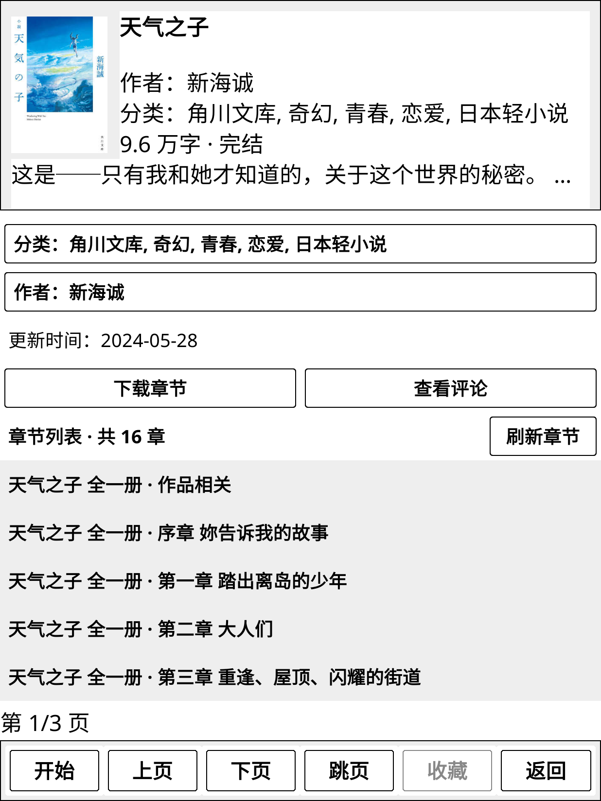

# PicaYomi

[简体中文](README.md)

A manga and novel reader plugin for [KOReader](https://github.com/koreader/koreader), designed primarily for Kindle and other e-ink devices. It supports multiple sources, search, streaming, chapter downloads, favorites, and reading history.

**The plugin interface currently supports Chinese only.** This page is an introduction; the [Chinese README](README.md) contains the full user guide. Compatibility with devices other than Kindle needs testing.

**Sources: [PicaYomi Sources](https://github.com/UFOAlastor/PicaYomi_Sources)** · [Default subscription](https://raw.githubusercontent.com/UFOAlastor/PicaYomi_Sources/main/packages/index.json)

## Preview

| Home | Manga details | Novel details | Novel reading |
|---|---|---|---|
|  |  |  |  |

## Installation

1. Install and verify KOReader on your device.
2. Download **`picayomi.koplugin-<version>.zip`** from the [latest release](https://github.com/UFOAlastor/koreader_PicaYomi/releases/latest).
3. Extract it and copy the **`picayomi.koplugin`** folder into **`koreader/plugins/`**.
4. Restart KOReader and open PicaYomi from the Tools menu (工具).

Use the plugin ZIP attached to the release. GitHub's automatically generated “Source code” archives are source snapshots.

## Getting started

Select a source on the home page and sign in if the source requires it. Open a title to read online or use 下载章节 (Download chapters) to save chapters for offline reading. Offline chapters are available from 已下载 (Downloaded) on the home page. Downloads pause while reading and resume when you leave the reader. Exiting PicaYomi stops all downloads and keeps saved chapters; retry incomplete chapters from Downloaded.

The home page places source selection and account access at the top, with Settings, Search, and Exit at the bottom. Favorites, History, and Downloaded show cover previews: tap a heading to open its list, or a cover to start or resume reading. Leaving the reader shows details, then returns to the original home page. Continue Reading in a list opens the reader directly; leaving it shows details, then returns to that list. Landscape layouts reuse available space. On smaller screens, download, history, and favorite previews are hidden in that order while text actions remain visible, without scrolling or pagination.

Sources are managed under 设置 → 源管理 (Settings → Source management). The default subscription is already configured. Automatic source update checks are disabled by default; when enabled, downloading an update still requires confirmation. Source changes take effect after restarting KOReader.

Search, History, and Cancel close the search input. Returning from search history or results goes back to the calling page. Every nonempty submitted keyword is saved to search history, including failed requests, timeouts, and searches with no results.

Long-press an illustration, tap **保存插图 (Save illustration)** in the image viewer, and choose a folder to save it.

Novels support illustrated novel reading, chapter navigation, typography settings, resume, offline downloads, and configurable chapter preloading. Install **Wenku8** or **BiliNovel** from Settings → Source Management → Update Sources (all subscriptions), then restart KOReader. If the plugin version is incompatible, update the plugin from [Releases](https://github.com/UFOAlastor/koreader_PicaYomi/releases/latest) first. Wenku8 browsing requires a personal account; BiliNovel search may be blocked by site verification and its online bookshelf is unavailable. Local favorites remain available.

See [Releases](https://github.com/UFOAlastor/koreader_PicaYomi/releases) and the [Chinese changelog](CHANGELOG.md) for version changes and upgrade notes.

To update the plugin, exit KOReader, replace the plugin folder with the new release, and restart. Keep the KOReader data directory to preserve accounts, settings, favorites, history, and downloads; back up important data first.

For ordinary KOReader books, enable **设置 → 操作与手势 → 原生 Reader 边缘返回** (Native Reader edge back, off by default). Swipe inward from an allowed edge to save your reading position and return to the file browser. This switch is independent; reading inside PicaYomi still returns to the work details.

Chapter selection offers **Select all chapters** and **Select unread chapters** on the same row. The download deletion dialog offers **Delete all** and **Delete read**. Partially read chapters and older history without confirmed completion are preserved by Delete read.

## Help and contribution

- [Report a bug or request a feature](https://github.com/UFOAlastor/koreader_PicaYomi/issues): include plugin/source versions, KOReader version, device model, and steps to reproduce. Reports in Chinese or English are welcome.
- [Contributing](https://github.com/UFOAlastor/koreader_PicaYomi/blob/main/.github/CONTRIBUTING.md) · [Security policy](https://github.com/UFOAlastor/koreader_PicaYomi/blob/main/.github/SECURITY.md)
- [Diagnostic logging (Chinese)](docs/DEBUG.md): release builds disable debug logging by default. Remove credentials, session data, and personal reading information before sharing logs or screenshots.
- [Source SDK and authoring guides (Chinese)](https://github.com/UFOAlastor/PicaYomi_Sources)

## License and disclaimer

Project code is licensed under the [MIT License](LICENSE). See [third-party notices](THIRD_PARTY.md) for bundled components. Thanks to [PicaComic](https://github.com/Pacalini/PicaComic), [rakuyomi](https://github.com/hanatsumi/rakuyomi), and KOReader for design references.

This project is for learning and technical exchange. It does not provide or host manga or novel content; copyrights belong to their respective owners. Follow local laws and platform rules, support authorized releases, and use the project at your own responsibility.
