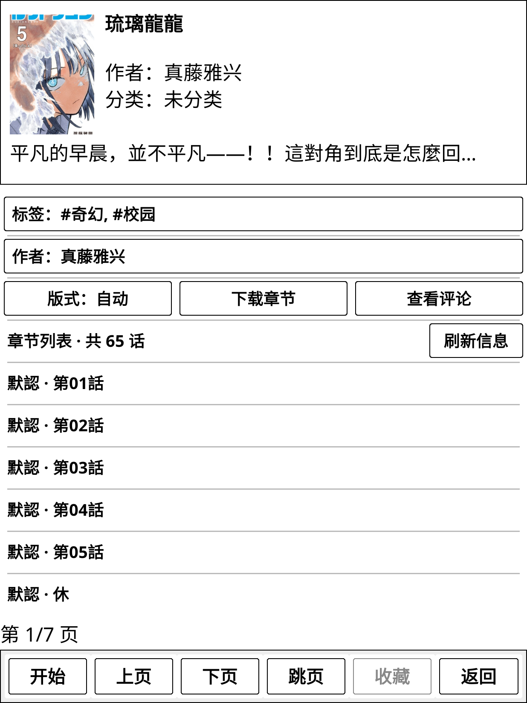
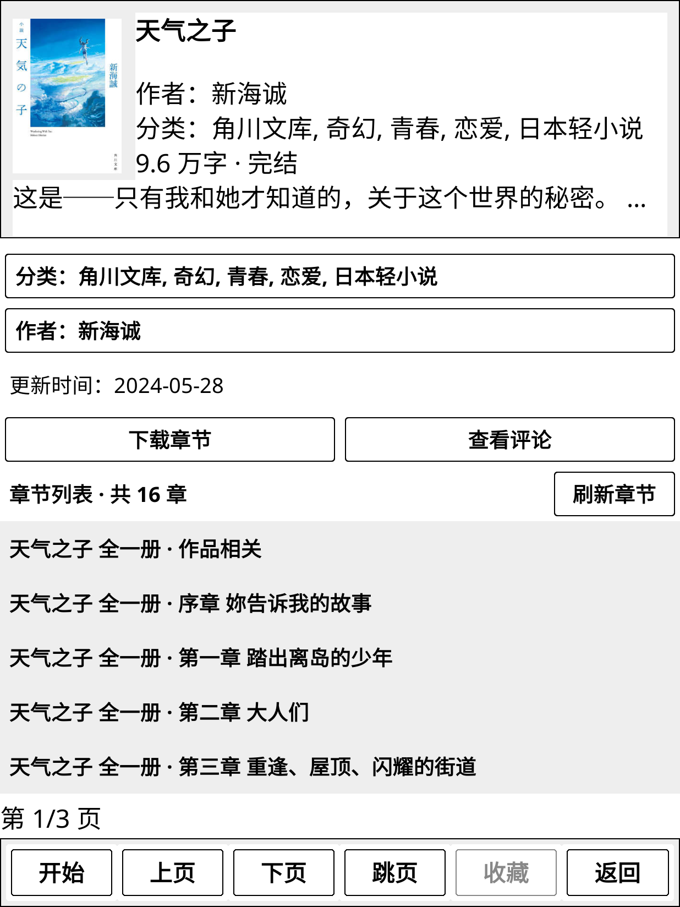

# PicaYomi

[English introduction](README.en.md)

面向 Kindle 等设备的 [KOReader](https://github.com/koreader/koreader) 漫画与小说阅读插件。支持多源浏览、搜索、流式阅读、漫画图像增强、章节下载、收藏和阅读历史，针对墨水屏提供刷新、版式与内存管理设置。

**漫画与小说源仓库：[PicaYomi Sources](https://github.com/UFOAlastor/PicaYomi_Sources)** · [默认订阅地址](https://raw.githubusercontent.com/UFOAlastor/PicaYomi_Sources/main/packages/index.json)

## 页面预览

| 主页 | 漫画详情 | 小说详情 | 小说阅读 |
|---|---|---|---|
|  |  |  |  |


## 安装

设备需已安装并能正常运行 KOReader。

1. 从 [Releases](https://github.com/UFOAlastor/koreader_PicaYomi/releases) 下载附件 **`picayomi.koplugin-<版本>.zip`**。
2. 解压后，将 **`picayomi.koplugin`** 文件夹直接复制到设备的 **`koreader/plugins/`** 目录，无需重命名。
3. 重启 KOReader，从“工具”菜单打开 PicaYomi。

安装后的路径为：

```text
koreader/
└── plugins/
    └── picayomi.koplugin/
        ├── main.lua
        └── _meta.lua
```

> Kindle 通过 USB 连接电脑后，打开设备盘中的 `koreader/plugins/` 即可。下载 Release 中的插件 ZIP 附件；GitHub 自动生成的 “Source code” 压缩包是源码归档。

## 漫画与小说源管理

可用源、源版本和安装说明见独立的[漫画与小说源仓库](https://github.com/UFOAlastor/PicaYomi_Sources)。

在 **设置 → 源管理** 中管理漫画与小说源及订阅。插件预置默认订阅，无需手动输入地址。

自动检查更新默认关闭。开启后，在已联网且首页空闲时检查已安装的源；**发现更新先询问，点击“下载更新”才下载**，完成后提供 **“立即重启 KOReader”／“稍后”**。没有更新不提示，选择稍后在本次运行中不重复询问；检查或下载失败会说明原因。

> 成功检查后 6 小时内不再自动检查，手动更新不受此限制。不会自动开启 Wi-Fi、添加新源或恢复已卸载的源。
>
> 删除全部订阅后，订阅管理会显示“恢复默认订阅”，无需重新输入地址。

## 小说阅读

进入 **设置 → 源管理 → 更新源（全部订阅）**，安装 **轻小说文库**、**哔哩轻小说**或**轻之国度**，再正常重启 KOReader。小说源需要单独安装；也可在默认订阅选择“更新源（含新源）”。若提示插件版本不兼容，请先从 [Releases](https://github.com/UFOAlastor/koreader_PicaYomi/releases/latest) 升级插件。

轻之国度支持图文阅读、个人在线书架及只读评论；使用自己的站点账号，下载须满足站点授权要求。

首页按漫画、小说分组切源。小说支持按题材浏览、查看详情和目录、图文阅读、直接切章、收藏、续读及离线下载。字体和排版在阅读页使用 KOReader 设置；长按插图进入大图页，点击“保存插图”选择目录即可另存图片；可设置提前加载后续 0～5 章，默认 1 章。长目录及章节加载会显示阶段与等待时间，可取消；退出阅读时显示返回提示。

轻小说文库的搜索、推荐、最新、分类及在线书架需要个人账号。哔哩支持匿名分类浏览，搜索可能受站点验证限制；在线书架和分页回复暂不可用，可使用本地收藏。下架、受限或不完整章节会提示错误。评论只供查阅，不支持发表。

## 第一次使用

1. 从 KOReader 的“工具”菜单进入 PicaYomi，在首页切换到要使用的漫画或小说源。
2. 按源站要求登录；支持匿名浏览的源可直接使用。未登录也可切换源、打开设置和使用已下载内容；需要登录的在线操作会在点击时提示。推荐、最新、分类、排行等入口取决于当前源的能力。
3. 搜索或浏览作品，点击条目进入详情。**开始**从第一章第一页阅读，**继续**恢复已有进度，也可以直接选择章节。
4. 阅读前建议看一遍 **设置 → 阅读设置** 和 **设置 → 操作与手势**，特别是翻页刷新、条漫滚动和边缘返回。

## 手势与页面操作

首页上方可切换内容源或打开账号，底栏依次为“设置、搜索、退出”。收藏、历史和已下载支持封面预览：点击标题进入列表，点击封面直接开始或继续阅读。退出阅读先回到详情，详情再返回原来的主页。列表中的“继续阅读”也会直接打开阅读器，退出阅读后返回详情，再回到原列表。

横屏会重新排布预览和功能入口；空间不足时依次收起已下载、历史、收藏的封面，保留文字入口，无需滚动或翻页。

搜索时，点击“搜索”“历史”或“取消”都会关闭输入框；从历史页或搜索结果返回时回到原页面。提交非空关键词即保存搜索历史，失败、超时或没有结果也会保留。

下载选择可使用同排的“全选章节”和“全选未读章节”；已下载内容不重复选择。在“删除下载”提示窗中，可选择“删除全部”或“删除已读”。未读和半读章节会在删除已读时保留；无法确认读完的旧历史也会保留。

详情、下载和设置页统一使用圆角描边的操作入口；灰色文字表示说明或暂不可用。章节与漫画列表仍可整行点击，设置项右侧显示当前值。

以下滑动操作适用于触屏设备。手势从哪里开始很重要：从边缘起手与从屏幕中间起手的含义不同。

| 页面／操作 | 使用方式 |
|---|---|
| 返回上一页 | 从左边缘向右滑，或从右边缘向左滑；也可以点击页面的“返回” |
| 列表、分类、设置菜单翻屏 | 在屏幕中间左滑到下一屏、右滑到上一屏；到首尾后停止，不循环 |
| 列表继续阅读 | 有阅读历史的漫画右上角显示“继续阅读”，点击后自动续读；退出阅读先回该漫画详情，再返回原列表 |
| 顶部下拉菜单 | 在 PicaYomi 主页、列表、详情或设置页从顶部向下拉，打开 KOReader 原生菜单，查看时间、电量或切换设置/插件；关闭菜单回到原页面 |
| 退出 PicaYomi | 顶部下拉后，在“工具”中点击“退出 Picayomi”回到 KOReader 书籍页；漫画阅读中的“返回 Picayomi”退出阅读并回到原漫画详情 |
| 整页漫画阅读 | 翻页点击区域和阅读器菜单沿用 KOReader 的配置；从边缘向内滑可退出当前阅读页 |
| 漫画放大 | 阅读菜单“排版 → 面板缩放（漫画）”开启“允许面板缩放”后，长按图片进入整页图片视图，再双指缩放、拖动平移；暂不自动识别分格 |
| 保存当前页原图 | 漫画阅读顶部菜单“工具 → 保存当前页原图”，位于上一话、下一话之后；选择保存目录，记住上次成功位置，同名文件另存。保存已下载的源图片，不含状态栏；需还原的图片按原尺寸导出 PNG，内存不足时提示失败 |
| 条漫阅读 | 在屏幕中部上下滑动或拖动；边缘竖向手势留给 KOReader 的亮度等操作 |
| 单本漫画版式 | 在作品详情点击“版式”，循环切换竖屏、条漫、横屏；单本设置优先；自动判断优先使用章节中段图片，避开封面/开头跨页 |
| 阅读历史 | 封面地址与进度持久保存；清缓存后可重新加载封面，旧记录显示时异步补齐 |
| 评论 | 点击查看完整内容；全文及回复取决于源能力与登录状态，不提供发表 |
| 标题太长 | 点击详情页标题查看完整文字 |
| 删除一条阅读历史 | 长按对应历史条目，按提示删除 |
| 删除一条搜索历史 | 在搜索历史页长按关键词，点击“删除”确认；取消会保留记录 |

在 **设置 → 操作与手势** 中可以关闭边缘返回，或指定仅左侧／仅右侧生效。默认两侧都可用，边缘宽度为屏幕的 5%（可选 3%／5%／8%）；容易误触时调窄，戴保护壳或不易触发时调宽。此组设置修改后立即生效。

普通 KOReader 阅读也可使用边缘返回：在 **设置 → 操作与手势 → 原生 Reader 边缘返回** 中开启（默认关闭），从允许的边缘向内滑动即可保存阅读位置并回到文件浏览器。这个开关独立控制普通阅读，PicaYomi 内阅读仍返回作品详情。

## 阅读、下载与收藏

- **章节目录**：再次进入详情优先显示本地目录；五分钟内直接复用，过期后后台检查变化。章节汇总行同时显示总数和上次阅读章节，右侧“刷新章节”可立即检查，点击后显示“刷新中…”，结束时提示已是最新或章节已更新；刷新失败保留原有列表。
- **在线阅读**：当前页按需下载，后续图片可提前下载。进入章节无需等整章下载完成。
- **漫画显示增强**：在“设置 → 阅读设置”选择锐化、降噪＋锐化，减少噪点、强化文字与线条边缘，可叠加加深或柔和对比度；细节增强与色调调整默认关闭。小图可保边放大以适配屏幕，独立于细节增强开关；大图支持自适应加速。开启提前加载后，会尽可能预先准备下一页的增强效果；增强仍可能增加等待时间，资源不足时部分图片会跳过增强。柔和对比度会改变灰阶与阴影观感，可按喜好关闭。保留下载原图，更改设置后重新打开章节生效。
- **离线阅读**：在详情页点击“下载章节”，选择需要的章节；完成后从首页“已下载”打开。阅读时下载队列会暂停，退出阅读后继续。断网时保留任务，联网或唤醒后恢复；连续连接失败停止重试，可在下载页手动重试。退出整个 PicaYomi 会停止全部下载，保留已下载文件；未完成章节可在下载页重试。
- **自动下一章**：在“设置 → 阅读设置”开启，漫画和小说读到章末时，有下一章便直接加载；默认关闭，保留章末询问。加载失败后可手动切章重试。
- **作品评论**：支持的源可在作品详情查看评论，点击查看完整内容；回复是否可读取决于源能力与登录状态。拷贝漫画支持作品评论，不提供评论发表或章节吐槽。
- **缓存与下载的区别**：在线阅读缓存可能被自动清理；希望断网后仍能阅读的章节，应使用“下载章节”主动保存。
- **收藏与历史**：源站收藏需要对应账号与源支持，本地收藏保存在设备上。通过阅读历史可继续上次进度。

阅读历史、进度、本地收藏和账号独立持久化，不随缓存清理而删除，也不会因条目数量增加自动淘汰。清除缓存会删除可重新获取的图片、小说正文和章节目录，保留主动下载的内容；目录重新加载后仍可按历史续读。

## 建议关注的设置

| 设置入口 | 作用与选择 |
|---|---|
| 阅读设置 → 图片模式 | 默认跟随 KOReader 与设备能力；“始终黑白”可减少彩色图片的内存开销 |
| 阅读设置 → 图片质量（仅哔咔） | 原图优先清晰度，缩略图减少流量；不影响其他漫画源 |
| 阅读设置 → 提前加载章节数（小说） | 切换到小说源后可设 0～5 章，默认 1；0 关闭。提前准备后续章节，仍可能需要等待网络加载 |
| 阅读设置 → 提前加载页数 | 默认 3 页，可设 0～9；0 表示关闭。提前下载后续图片；开启细节增强时，也会尽可能提前准备下一页的增强效果，减少翻页等待 |
| 阅读设置 → 漫画细节增强／漫画色调调整 | 分别选择锐化或降噪＋锐化、加深或柔和对比度，两类效果可叠加；默认不处理细节、不调整色调 |
| 阅读设置 → 自动下一章 | 默认关闭；开启后漫画与小说在有下一章时直接继续，无需章末确认 |
| 阅读设置 → 息屏继续下载 | 默认开启，控制主动下载的漫画和小说章节；关闭后息屏暂停、亮屏联网后继续。系统深度休眠时仍可能暂停 |
| 阅读设置 → 翻页刷新 | 默认完整刷新，减少墨水屏残影；选“跟随系统”可减少完整刷新，但可能留下残影 |
| 阅读设置 → 条漫滚动阅读 | 默认按画面长宽比自动判断，也可强制滚动或整页翻页；单本可在详情页覆盖 |
| 阅读设置 → 横屏方向 | 横屏画面方向不顺手时，在顺时针与逆时针 90° 之间切换 |
| 操作与手势 | 调整边缘返回开关、允许的边缘与触发宽度 |
| 存储管理 | 查看漫画与小说缓存、下载占用；可分别清缓存或删除下载，清缓存保留主动下载和阅读进度 |
| 小说固定文案过滤 | 在小说阅读设置或源设置中编辑需要过滤的固定文案，下次打开章节生效 |
| 源管理 → 自动检查更新 | 默认关闭；发现可信签名源的更新后先询问，确认才下载，新源仍通过手动更新添加 |

图片模式、条漫策略、横屏方向等阅读设置建议在退出章节后调整，再重新打开章节。提前加载页数并非越大越好：网络较慢或设备负担较重时，可适当降低。

## 更新与卸载

版本变化与升级注意事项见 [Releases](https://github.com/UFOAlastor/koreader_PicaYomi/releases)及[更新记录](CHANGELOG.md)，安装包从 [Release 附件](https://github.com/UFOAlastor/koreader_PicaYomi/releases/latest)下载。

在“设置 → 关于”的版本号旁点击“检查更新”，确认下载后，正常重启 KOReader 即可启用。设置首页可开启“自动检查插件更新”（默认关闭），下载仍需确认。下载失败或取消不会替换正在使用的版本；新版启动未完成时会尝试恢复上一版，关于页也提供可用的上一版恢复入口。宿主不支持在线安装时，仍可手动更新。

手动更新时退出 KOReader，用新版 `picayomi.koplugin` 替换旧插件目录，再启动 KOReader。设置、账号、收藏、历史和下载保存在 KOReader 数据目录中；替换插件时保留该数据目录，重要数据建议先备份。

源版本独立于插件。通过预置订阅更新后重启生效，保留账号、收藏、历史和下载。源详情保留启用、禁用、站点设置及卸载入口。

卸载时退出 KOReader，移除 `plugins/picayomi.koplugin` 后重启。移除插件目录不会自动清除保存在 KOReader 数据目录中的阅读数据。

## 常见问题与限制

- **源未出现在首页**：检查是否被禁用或卸载；安装或启用后重启 KOReader。
- **息屏断网或图片加载失败**：已下载或已缓存的页面仍可阅读；未缓存页会提示连接网络。加载失败会说明是否自动重试，也可点击“重试”；关闭提示后仍可返回或继续翻页。

- **Wi-Fi 已连接但加载失败**：检查源站可访问性、源版本及登录状态；网络连接不等于源站可用。
- **彩色设备仍为黑白**：检查 KOReader 的彩色设置及插件图片模式，退出章节后重新打开。
- **大图无法打开**：超长图和设备内存不足仍可能导致加载失败；部分大图格式对内存要求较高。
- **设备与账号兼容**：主要适配 Kindle，其他设备需要实际验证；部分账号功能尚缺完整验证，具体限制以对应源的说明为准。

## 问题反馈与文档

请通过 [Issues](https://github.com/UFOAlastor/koreader_PicaYomi/issues) 提供插件版本、KOReader 版本、设备型号、源名称与版本、复现步骤及报错信息。发布版本默认关闭诊断日志，需要排查时按下面的说明临时开启；分享日志前删除账号、会话和个人阅读内容。

- [诊断日志](docs/DEBUG.md)
- [内容源 SDK、模板与制作指南](https://github.com/UFOAlastor/PicaYomi_Sources)
- [参与贡献](https://github.com/UFOAlastor/koreader_PicaYomi/blob/main/.github/CONTRIBUTING.md) · [安全问题反馈](https://github.com/UFOAlastor/koreader_PicaYomi/blob/main/.github/SECURITY.md)
- [MIT 许可证](LICENSE)与[第三方说明](THIRD_PARTY.md)

感谢 [PicaComic](https://github.com/Pacalini/PicaComic)、[rakuyomi](https://github.com/hanatsumi/rakuyomi) 和 KOReader 提供的设计参考。

## 许可证

本项目代码采用 [MIT License](LICENSE)。第三方组件保留各自的版权与许可声明。

## 使用说明与免责声明

本项目仅供学习与技术交流，不提供或托管漫画、小说内容，作品版权归相关权利人所有。请遵守当地法律及平台规则，支持正版，并自行承担使用责任。
