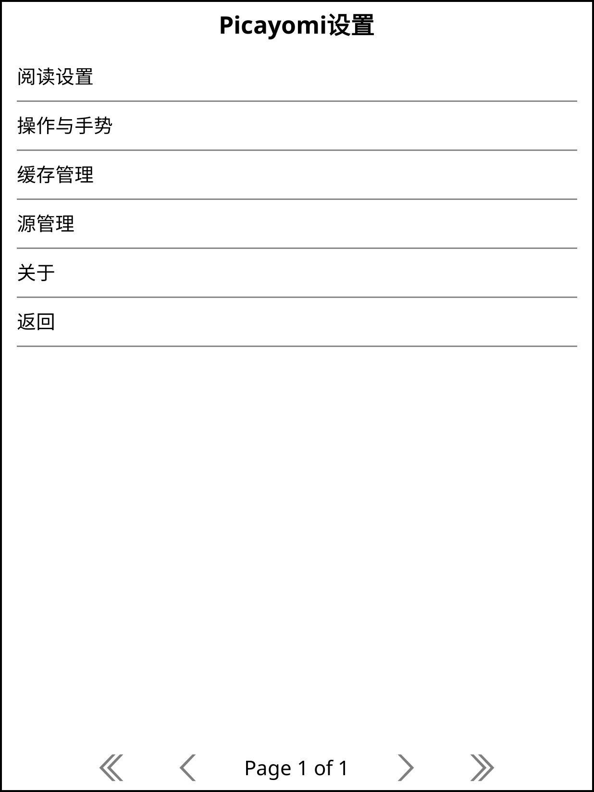
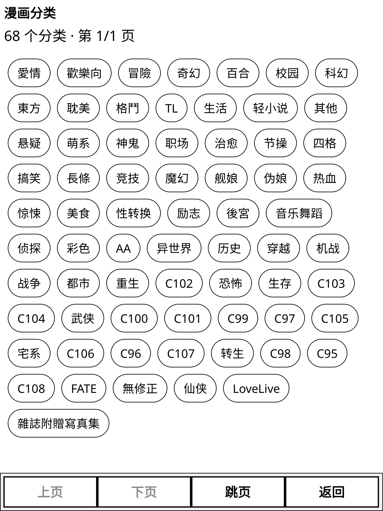
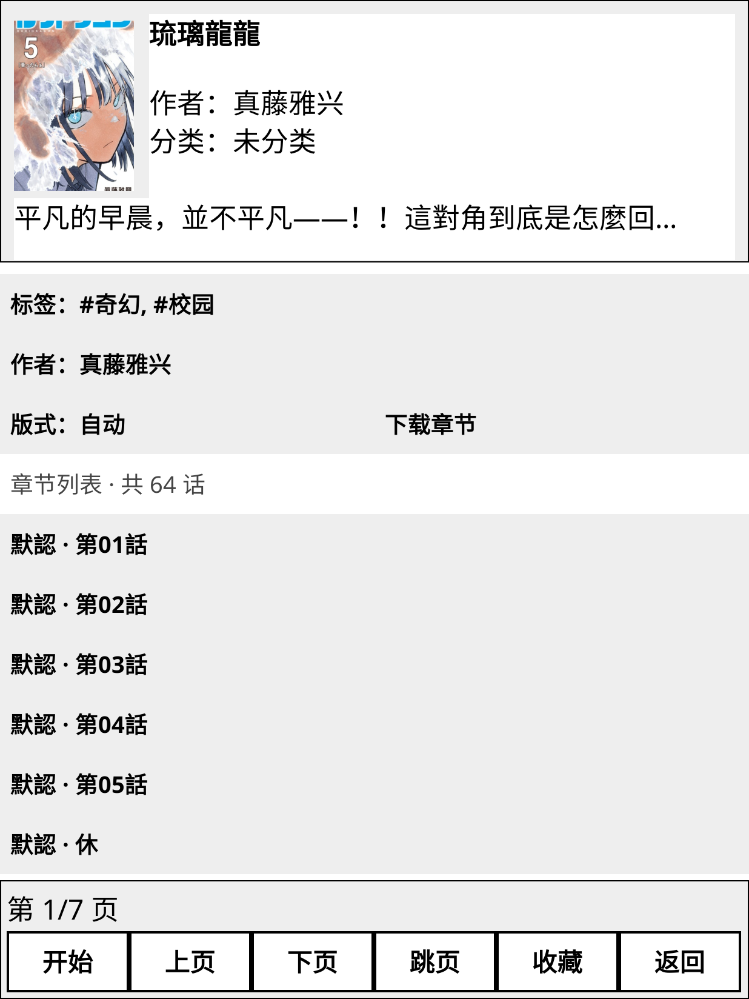

# PicaYomi

面向 Kindle 等设备的 [KOReader](https://github.com/koreader/koreader) 漫画阅读插件。支持多源浏览、搜索、流式阅读、章节下载、收藏和阅读历史，针对墨水屏提供刷新、版式与内存管理设置。

本文使用说明适用于 **0.11.3**。安装前请核对仓库 `_meta.lua` 或安装包版本；旧版本可能不含下述功能。漫画源独立分发，可用功能及最低插件版本由各源决定。

## 页面预览

以下为 copymanga 未登录状态下的模拟器截图，实际显示会随设备、字体及源站内容变化。

| 主页 | 设置 |
|---|---|
|  |  |

| 漫画列表 | 分类 |
|---|---|
|  |  |

### 漫画详情

## 安装

设备需已安装并能正常运行 KOReader。

1. 通过仓库的 **Code → Download ZIP** 下载源码，解压后找到直接包含 `main.lua` 和 `_meta.lua` 的目录。
2. 将该目录重命名为 `picayomi.koplugin`，复制到 KOReader 的 `plugins/` 目录。若使用已提供的插件安装包，直接复制其中的同名目录即可。
3. 确认目录结构为 `koreader/plugins/picayomi.koplugin/main.lua`，避免额外套一层文件夹。
4. 重启 KOReader，从“工具”菜单打开 PicaYomi。插件为 Lua 代码，无需编译。

Kindle 上请复制真实文件夹，不使用符号链接。

## 安装漫画源

插件附带哔咔、禁漫、绅士漫画三个基础源，并预置 [PicaYomi MangaSources](https://github.com/UFOAlastor/PicaYomi_MangaSources) 的签名订阅。无需输入链接或导入文件。

需要拷贝漫画时，进入 **设置 → 源管理 → 订阅管理 → 订阅：PicaYomi 漫画源 → 更新漫画源（含新源）**。插件获取并验证目录与源包，完成后重启 KOReader。自动更新不会恢复主动卸载的源；手动“更新漫画源（含新源）”可重新安装 copymanga。成功后可点击“立即重启 KOReader”，也可稍后从源管理重启。

自动检查更新默认关闭。开启后，每次启动 KOReader 的进程最多在已联网且首页空闲时检查一次，同时遵守 24 小时间隔及失败退避；返回首页和翻页不会反复检查。开启后会自动更新已安装且已信任的签名源，不会添加新源或重启阅读器。

## 第一次使用

1. 从 KOReader 的“工具”菜单进入 PicaYomi，在首页切换到要使用的漫画源。首次使用 `copymanga` 时，先按上面的订阅步骤安装。
2. 按源站要求登录；支持匿名浏览的源可直接使用。推荐、最新、分类、排行等入口取决于当前源的能力。
3. 搜索或浏览作品，点击条目进入详情。**开始**从第一章第一页阅读，**继续**恢复已有进度，也可以直接选择章节。
4. 阅读前建议看一遍 **设置 → 阅读设置** 和 **设置 → 操作与手势**，特别是翻页刷新、条漫滚动和边缘返回。

## 手势与页面操作

以下滑动操作适用于触屏设备。手势从哪里开始很重要：从边缘起手与从屏幕中间起手的含义不同。

| 页面／操作 | 使用方式 |
|---|---|
| 返回上一页 | 从左边缘向右滑，或从右边缘向左滑；也可以点击页面的“返回” |
| 列表、分类、设置菜单翻屏 | 在屏幕中间左滑到下一屏、右滑到上一屏；到首尾后停止，不循环 |
| 整页漫画阅读 | 翻页点击区域和阅读器菜单沿用 KOReader 的配置；从边缘向内滑可退出当前阅读页 |
| 条漫阅读 | 在屏幕中部上下滑动或拖动；边缘竖向手势留给 KOReader 的亮度等操作 |
| 单本漫画版式 | 在作品详情点击“版式”，循环切换竖屏、条漫、横屏；单本设置优先于全局自动判断 |
| 标题太长 | 点击详情页标题查看完整文字 |
| 删除一条阅读历史 | 长按对应历史条目，按提示删除 |

在 **设置 → 操作与手势** 中可以关闭边缘返回，或指定仅左侧／仅右侧生效。默认两侧都可用，边缘宽度为屏幕的 8%；容易误触时调窄，戴保护壳或不易触发时调宽。此组设置修改后立即生效。

## 阅读、下载与收藏

- **在线阅读**：当前页按需下载，后续图片可提前下载。进入章节无需等整章下载完成。
- **离线阅读**：在详情页点击“下载章节”，选择需要的章节；完成后从首页“已下载”打开。阅读时下载队列会暂停，退出阅读后继续。
- **缓存与下载的区别**：在线阅读缓存可能被自动清理；希望断网后仍能阅读的章节，应使用“下载章节”主动保存。
- **收藏与历史**：源站收藏需要对应账号与源支持，本地收藏保存在设备上。通过阅读历史可继续上次进度。

## 建议关注的设置

| 设置入口 | 作用与选择 |
|---|---|
| 阅读设置 → 图片模式 | 默认跟随 KOReader 与设备能力；“始终黑白”可减少彩色图片的内存开销 |
| 阅读设置 → 图片质量（仅哔咔） | 原图优先清晰度，缩略图减少流量；不影响其他漫画源 |
| 阅读设置 → 提前加载页数 | 默认 3 页，可设 0～9；0 表示关闭。这是在线图片的提前下载，不是提前解码，已下载章节不需要网络预取 |
| 阅读设置 → 翻页刷新 | 默认完整刷新，减少墨水屏残影；选“跟随系统”可减少完整刷新，但可能留下残影 |
| 阅读设置 → 条漫滚动阅读 | 默认按画面长宽比自动判断，也可强制滚动或整页翻页；单本可在详情页覆盖 |
| 阅读设置 → 横屏方向 | 横屏画面方向不顺手时，在顺时针与逆时针 90° 之间切换 |
| 操作与手势 | 调整边缘返回开关、允许的边缘与触发宽度 |
| 缓存管理 | 查看占用、设置最大缓存容量、清理封面和阅读缓存；缓存容量指存储空间，不是可分配内存 |
| 源管理 → 订阅管理 → 自动检查更新 | 默认关闭；开启后统一检查并更新已安装的可信签名源，新源仍通过手动更新添加 |

图片模式、条漫策略、横屏方向等阅读设置建议在退出章节后调整，再重新打开章节。提前加载页数并非越大越好：网络较慢或设备负担较重时，可适当降低。

## 更新与卸载

更新插件时退出 KOReader，用新版 `picayomi.koplugin` 替换旧插件目录，再启动 KOReader。设置、账号、收藏、历史和下载保存在 KOReader 数据目录中；替换插件时保留该数据目录，重要数据建议先备份。

源版本独立于插件。通过预置订阅更新后重启生效，保留账号、收藏、历史和下载。源详情保留启用、禁用、站点设置及卸载入口。

卸载时退出 KOReader，移除 `plugins/picayomi.koplugin` 后重启。移除插件目录不会自动清除保存在 KOReader 数据目录中的阅读数据。

## 常见问题与限制

- **源未出现在首页**：检查是否被禁用或卸载；安装或启用后重启 KOReader。
- **Wi-Fi 已连接但加载失败**：检查源站可访问性、源版本及登录状态；网络连接不等于源站可用。
- **彩色设备仍为黑白**：检查 KOReader 的彩色设置及插件图片模式，退出章节后重新打开。
- **大图无法打开**：超长图和设备内存不足仍可能导致加载失败；较大的渐进式 JPEG 存在低内存限制。
- **设备与账号兼容**：主要适配 Kindle，其他设备需要实际验证；部分账号功能尚缺完整验证，具体限制以对应源的说明为准。

## 问题反馈与文档

请通过 [Issues](https://github.com/UFOAlastor/koreader_PicaYomi/issues) 提供插件版本、KOReader 版本、设备型号、源名称与版本、复现步骤及报错信息。发布版本默认关闭诊断日志，需要排查时按下面的说明临时开启；分享日志前删除账号、会话和个人阅读内容。

- [诊断日志](docs/DEBUG.md)
- [低内存图片阅读设计](docs/IMAGE_MEMORY.md)
- [漫画源 SDK、模板与制作指南](https://github.com/UFOAlastor/PicaYomi_MangaSources)
- [代码来源与许可证状态](THIRD_PARTY.md)

感谢 [PicaComic](https://github.com/Pacalini/PicaComic)、[rakuyomi](https://github.com/hanatsumi/rakuyomi) 和 KOReader 提供的设计参考。

## 免责声明

本项目仅供学习、研究与技术交流，不内置漫画内容，也不提供内容托管服务。作品版权归原作者及相关权利人所有，请支持正版，勿下载、传播或分享未经授权的资源；误获取的盗版资源请立即删除，临时测试文件请于下载后 24 小时内清理。该时限不构成版权授权或免责依据。使用者应遵守所在地法律法规及内容平台的使用规则，并自行承担使用行为产生的责任。
